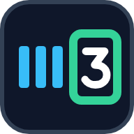
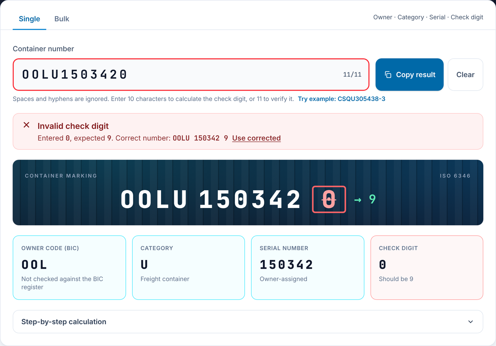
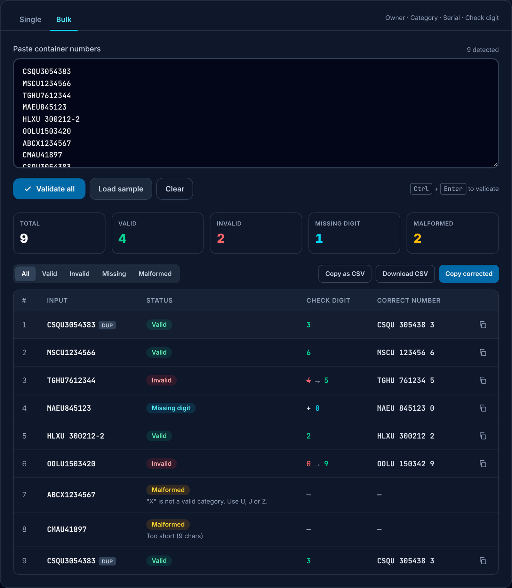

<p align="center">
  <a href="https://containercheck.app/" rel="noopener noreferrer">
    
  </a>
</p>

<div align="center">

# ContainerCheck

**ISO 6346 container check digit validator**: a static, client-side web app that calculates and verifies shipping container numbers, one at a time or in bulk.

🔗 **[containercheck.app](https://containercheck.app/)**


</div>

<div align="center">
  
  
</div>

---

## Overview

- **Single mode:** live validation as you type. It calculates the check digit from 10 characters or verifies it with 11, and shows a breakdown (owner code, category, serial, check digit) and the step-by-step calculation.
- **Bulk mode:** validates up to 2,000 numbers per run, with filters and duplicate detection. Results export as CSV or as a list of corrected numbers.
- **Built-in help:** user guidance lives in the app itself, in the *How to use* section of the page, so this repository carries no separate manual.
- **Private by design:** everything runs in the browser, with no backend, cookies, analytics or storage. Installable as a PWA and works offline.

## Algorithm

Digits keep their value. Letters map to `A=10 … Z=38`, skipping multiples of 11. Each of the first 10 values is multiplied by 2⁰…2⁹, and the check digit is `sum mod 11`, where a remainder of 10 becomes `0`. Example: `CSQU305438` → sum 6,185 → **3**.

Only the category identifiers `U`, `J` and `Z` are accepted. The implementation in `src/main.js` (§2) has been fuzz-tested against an independent implementation (200,000 random cases, 0 mismatches). Reference: [ISO 6346](https://en.wikipedia.org/wiki/ISO_6346) and [BIC](https://www.bic-code.org/identification-number/).

## Security, privacy and accessibility

- **Security:** strict CSP with Trusted Types (no `innerHTML`, `eval` or inline code), SRI on every script and stylesheet, HTTP security headers (`public/_headers`), and no third-party resources. Production dependencies: `npm audit --omit=dev` → 0. Full control matrix, accepted risks and hosting details: **[SECURITY.md](SECURITY.md)**.
- **Privacy:** no personal data is processed by the app. The GDPR notice is at [containercheck.app/legal](https://containercheck.app/legal).
- **Accessibility:** targets WCAG 2.2 AA. Checked with axe-core (0 violations, light and dark), keyboard tests, 320 px reflow, and a print stylesheet.

## Tech stack

| Layer | Choice |
|---|---|
| UI | HTML5 + vanilla JavaScript (ES modules, no framework) |
| Styling | Tailwind CSS 4 (compiled), Inter + JetBrains Mono (self-hosted) |
| Build | Vite 6 · vite-plugin-pwa · custom SRI plugin |
| Hosting | Cloudflare Workers (static assets) at containercheck.app, built from Git · CI on GitHub Actions |

### Project structure
```
├── index.html               # The app: markup + CSP meta (no inline scripts or styles)
├── legal.html               # Privacy policy, legal notice, accessibility contact
├── src/
│   ├── main.js              # ISO 6346 logic, safe DOM rendering, single + bulk modes
│   └── styles.css           # Tailwind entry, fonts, anti-framing rule
├── public/
│   ├── _headers             # HTTP security headers served by Cloudflare (CSP, HSTS, XFO…)
│   ├── robots.txt, sitemap.xml, og-image.png
│   ├── security-init.js     # Anti-clickjacking + initial theme (runs before paint)
│   └── favicon.svg / *.png / favicon.ico  # Logo and icons
├── vite.config.js           # Tailwind, PWA, SRI plugin, dev-only CSP relaxation
├── wrangler.jsonc           # Cloudflare Worker: serve ./dist, no workers.dev / preview URLs
├── .github/workflows/
│   └── ci.yml               # Audit + build check on every push / PR (no deploy rights)
└── SECURITY.md
```

---

## Getting started

**Prerequisites:** Node.js ≥ 20 and npm ≥ 9.

```bash
git clone https://github.com/irazu-fi/ISO-6346-Container-Validator.git
cd ISO-6346-Container-Validator
npm install
npm run dev        # http://localhost:5173/
```

| Script | Description |
|---|---|
| `npm run dev` | Dev server with hot reload (the CSP meta tag is removed in dev only) |
| `npm run build` | Production build to `dist/` (CSP + SRI applied) |
| `npm run preview` | Serves the production build locally. Use it for security testing |
| `npm run audit:prod` | Audits production dependencies |

---

## Deployment

Production is **https://containercheck.app**, served by a **Cloudflare Worker with static assets** (`iso-6346-container-validator`) and built from this repository. Every push to `main` is built and deployed automatically. The `*.workers.dev` and preview URLs are disabled in [`wrangler.jsonc`](wrangler.jsonc), so the site exists only on its own domain.

| Cloudflare build setting | Value |
|---|---|
| Production branch | `main` |
| Build command | `npm audit --audit-level=high && npm run build` |
| Deploy command | `npx wrangler deploy` (reads `wrangler.jsonc`, uploads `dist/`) |
| Node.js | from `.node-version` (22) |

On every push and pull request, [`.github/workflows/ci.yml`](.github/workflows/ci.yml) audits and builds the project. It has no deploy permissions and uses no secrets.

### Domain, TLS and DNS (Cloudflare)

- **TLS:** Universal certificate from Let's Encrypt for `containercheck.app` and `*.containercheck.app`, renewed automatically. *Always Use HTTPS* is on, the minimum version is TLS 1.2 and TLS 1.3 is enabled. `.app` is on the browsers' HSTS preload list.
- **`www`:** redirected to the apex with a permanent `301` by a Redirect Rule (`https://www.containercheck.app/*` → `https://containercheck.app/${1}`, query string preserved).
- **DNSSEC:** active.

The domain has no email, so these records lock it down against spoofing:

| Type | Name | Content | Purpose |
|---|---|---|---|
| Worker custom domain | `@` | `iso-6346-container-validator` | site |
| A (proxied) | `www` | `192.0.2.1` (reserved, never reached) | lets the Redirect Rule answer |
| MX | `@` | `.` (priority 0) | null MX, RFC 7505 |
| TXT | `@` | `v=spf1 -all` | no server may send mail |
| TXT | `_dmarc` | `v=DMARC1; p=reject; sp=reject; adkim=s; aspf=s` | reject spoofed mail |
| TXT | `*._domainkey` | `v=DKIM1; p=` | no valid DKIM keys |
| CAA | `@` | `0 issue "letsencrypt.org"`, `0 issuewild "letsencrypt.org"`, `0 iodef "mailto:jose.chaves@irazu.fi"` | only Let's Encrypt (Cloudflare adds its backup CAs automatically) |

---

## Monitoring

ContainerCheck is a static site with no server or database, so there is no `/health` endpoint. If the page is served, the app is available. External monitors (Olivia) check the published pages directly:

| Check | Request | Expect |
|---|---|---|
| App page | `GET` or `HEAD https://containercheck.app/` | `200`, body contains `Container Check Digit Validator` |
| Legal page | `GET https://containercheck.app/legal` | `200`, body contains `Who is responsible` |
| www redirect | `HEAD https://www.containercheck.app/` | `301` to `https://containercheck.app/` |
| TLS certificate | `containercheck.app:443` (the wildcard also covers `www`) | valid; issued by Let's Encrypt, renewed by Cloudflare |

- **No credentials:** the checks need no cookies, authentication or tokens, and the site sets no cookies and stores no data.
- **Text check works without JavaScript:** the expected texts are in the static HTML, so a plain HTTP check can see them.

---

## Contributing

Fork, create a feature branch, and open a pull request. Please keep the security rules: no `innerHTML` or inline scripts, and no third-party CDNs. CI (`npm audit --audit-level=high` + build) must pass.

---

## Author

**José Oldemar Chaves Urbina**
- GitHub: [@OldemarCRC](https://github.com/OldemarCRC)
- LinkedIn: [oldemar-chaves](https://www.linkedin.com/in/oldemar-chaves/)
- Portfolio: [oldemarcrc.github.io/my-portfolio](https://oldemarcrc.github.io/my-portfolio/)

---

## License

MIT. See [LICENSE.md](LICENSE.md).
